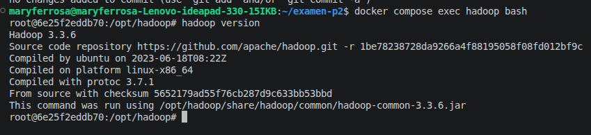
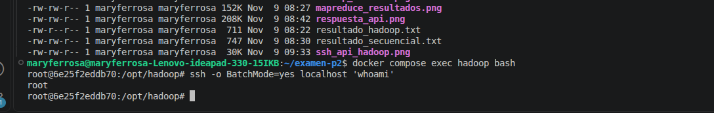
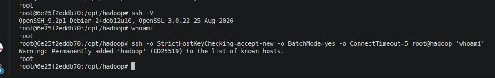
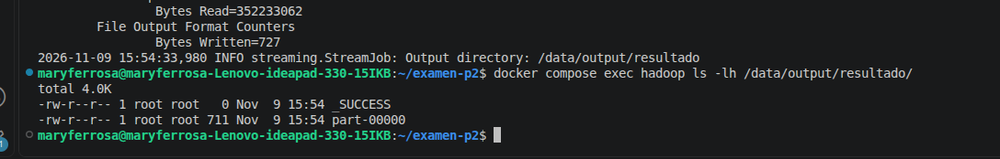
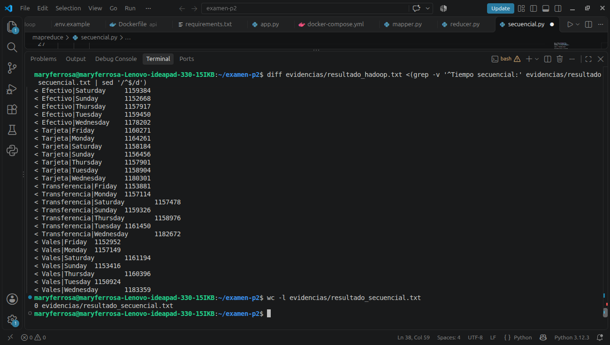
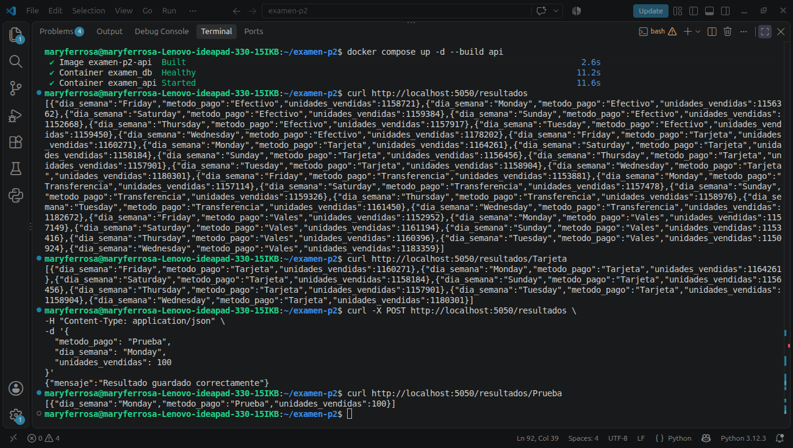
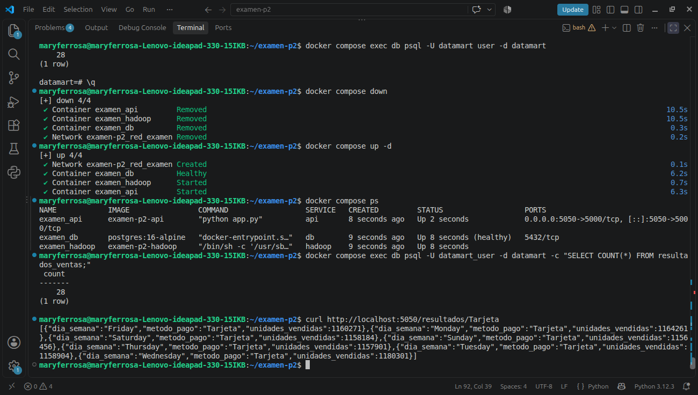

# Examen Segundo Parcial — Pipeline de Datos Contenerizado

## 1. Datos generales

**Matrícula:** 125053905

**Materia:** Manejo Masivo de Datos (Big Data)

**Proyecto:** Procesamiento de ventas con Hadoop MapReduce, PostgreSQL y Flask.

**Pregunta asignada:**

¿Cuántas unidades se vendieron por método de pago y día de la semana?

---

## 2. Descripción del proyecto

El objetivo de este proyecto es analizar un conjunto de datos de aproximadamente **5 millones de registros de ventas** utilizando Hadoop MapReduce.

Se busca conocer cuántas unidades se vendieron según el método de pago utilizado y el día de la semana.

Para comprobar los resultados, también se realiza el mismo análisis utilizando Python secuencial.

Finalmente, la información obtenida se almacena en PostgreSQL y se consulta mediante una API desarrollada con Flask.

### Tecnologías utilizadas

- **Python:** generación y procesamiento de datos.
- **Hadoop MapReduce:** procesamiento de grandes cantidades de información.
- **Docker:** ejecución de servicios en contenedores.
- **Docker Compose:** administración de los contenedores.
- **PostgreSQL:** almacenamiento de resultados.
- **Flask:** desarrollo de la API.
- **SSH:** comunicación segura entre contenedores.
- **GitHub:** almacenamiento y documentación del proyecto.

---

## 3. Estructura del proyecto

```text
examen-p2/
│
├── README.md
├── .gitignore
├── .env.example
├── docker-compose.yml
├── generar_dataset.py
│
├── data/
│   └── ventas_125053905.csv
│
├── hadoop/
│   └── Dockerfile
│
├── mapreduce/
│   ├── mapper.py
│   ├── reducer.py
│   └── secuencial.py
│
├── api/
│   ├── Dockerfile
│   ├── requirements.txt
│   ├── app.py
│   └── iniciar.sh
│
├── scripts/
│   └── cargar_resultados.py
│
└── evidencias/
    ├── hadoop_version.png
    ├── ssh_localhost.png
    ├── ssh_api_hadoop.png
    ├── mapreduce_resultados.png
    ├── job_hadoop.png
    ├── respuesta_api.png
    ├── evidencias-persistencia_postgresql.png
    ├── resultado_hadoop.txt
    ├── resultado_secuencial.txt
```

**Nota:** El archivo CSV no se sube a GitHub debido a su tamaño. Se genera localmente utilizando `generar_dataset.py`.

---

## 4. Desarrollo del proyecto

### 4.1 Generación del dataset

Se utilizó Python para generar aproximadamente **5 millones de registros de ventas**.

Cada registro contiene información como:

- Fecha y hora.
- Tienda.
- Categoría.
- Producto.
- Cantidad vendida.
- Precio unitario.
- Método de pago.

El dataset se genera utilizando la matrícula como semilla para obtener datos reproducibles.

**Comando:**

```bash
python3 generar_dataset.py 125053905
```

El archivo generado debe colocarse en la carpeta `data/`.

### 4.2 Creación de contenedores

Se utilizó Docker Compose para organizar tres servicios:

**Hadoop:** procesa el archivo CSV mediante MapReduce.

**PostgreSQL:** almacena los resultados del análisis.

**API Flask:** permite consultar y agregar información a la base de datos.

Los servicios se comunican mediante una red de Docker.

### 4.3 Configuración de Hadoop

Se creó un Dockerfile basado en Debian para instalar Java, Python y Hadoop.

Se configuraron las variables de entorno necesarias para ejecutar Hadoop.

Para comprobar su instalación se utilizó:

```bash
hadoop version
```

La versión utilizada fue **Hadoop 3.3.6**.

### 4.4 Configuración de SSH

Se configuró SSH mediante llaves para permitir conexiones sin contraseña.

Se realizaron dos comprobaciones:

1. Conexión SSH dentro del contenedor Hadoop mediante `localhost`.
2. Conexión SSH hacia Hadoop utilizando su nombre de servicio.

Esto permite comprobar la comunicación entre los servicios.

### 4.5 Procesamiento con MapReduce

Se desarrollaron dos programas en Python:

**mapper.py:** lee los registros y obtiene el método de pago, el día de la semana y la cantidad vendida.

**reducer.py:** agrupa los registros y suma las unidades vendidas para cada combinación.

Se utilizó Hadoop Streaming para ejecutar ambos programas.

**Comando utilizado:**

```bash
docker compose exec hadoop bash -c 'hadoop jar /opt/hadoop/share/hadoop/tools/lib/hadoop-streaming-3.3.6.jar \
-input /data/input/ventas_125053905.csv \
-output /data/output/resultado \
-mapper "python3 /opt/mapreduce/mapper.py" \
-reducer "python3 /opt/mapreduce/reducer.py"'
```

El procesamiento genera los resultados agrupados por método de pago y día de la semana.

Se obtuvieron **28 combinaciones**, correspondientes a cuatro métodos de pago y siete días de la semana.

### 4.6 Procesamiento secuencial

Se desarrolló `secuencial.py` para resolver la misma pregunta utilizando Python, sin Hadoop.

El programa lee el dataset y calcula las unidades vendidas por método de pago y día de la semana.

Este procedimiento permite comparar el rendimiento de ambos métodos.

### 4.7 Almacenamiento en PostgreSQL

Se utilizó PostgreSQL para almacenar los resultados obtenidos mediante MapReduce.

El script `cargar_resultados.py` permite insertar los registros procesados en la base de datos.

Se almacenaron **28 registros**, correspondientes a las combinaciones de métodos de pago y días de la semana.

### 4.8 Desarrollo de la API

Se desarrolló una API utilizando Flask para consultar los resultados almacenados.

Los endpoints implementados son:

| Método | Endpoint | Función |
|---|---|---|
| GET | `/resultados` | Consultar todos los resultados. |
| GET | `/resultados/Tarjeta` | Consultar resultados del método de pago Tarjeta. |
| POST | `/resultados` | Agregar un registro. |
| GET | `/salud` | Comprobar el funcionamiento de la API. |

La API utiliza el puerto **5050**.

---

## 5. Instrucciones para ejecutar el proyecto

### Paso 1. Descargar el repositorio

Clonar el repositorio desde GitHub y entrar a la carpeta del proyecto.

### Paso 2. Configurar las variables de entorno

Crear el archivo `.env` a partir de `.env.example`.

```bash
cp .env.example .env
```

Completar las variables necesarias para la conexión con PostgreSQL.

### Paso 3. Generar el dataset

```bash
python3 generar_dataset.py 125053905
```

Colocar el CSV generado dentro de la carpeta `data/`.

### Paso 4. Construir e iniciar los contenedores

```bash
docker compose up -d --build
```

### Paso 5. Comprobar los contenedores

```bash
docker compose ps
```

### Paso 6. Verificar Hadoop

```bash
docker compose exec hadoop hadoop version
```

### Paso 7. Ejecutar MapReduce

```bash
docker compose exec hadoop bash -c 'hadoop jar /opt/hadoop/share/hadoop/tools/lib/hadoop-streaming-3.3.6.jar \
-input /data/input/ventas_125053905.csv \
-output /data/output/resultado \
-mapper "python3 /opt/mapreduce/mapper.py" \
-reducer "python3 /opt/mapreduce/reducer.py"'
```

**Importante:** Hadoop no permite utilizar una carpeta de salida que ya existe. Si `/data/output/resultado` ya existe, es necesario utilizar otra ruta o retirar la salida anterior antes de repetir el procesamiento.

### Paso 8. Consultar los resultados

```bash
docker compose exec hadoop cat /data/output/resultado/part-00000
```

### Paso 9. Consultar la API

Abrir en el navegador:

```text
http://localhost:5050/resultados
```

Para consultar los resultados de pagos con tarjeta:

```text
http://localhost:5050/resultados/Tarjeta
```

**Nota:** La carga inicial de resultados en PostgreSQL depende de la configuración del servicio API y del script `cargar_resultados.py`.

---

## 6. Comparación de rendimiento

Se realizaron dos pruebas utilizando el mismo conjunto de datos.

| Método | Tiempo de ejecución |
|---|---:|
| Hadoop MapReduce | 151.41 segundos |
| Python secuencial | 146.48 segundos |

### Análisis de los resultados

En esta práctica, Python secuencial fue más rápido que Hadoop MapReduce.

Esto se debe a que Hadoop necesita tiempo adicional para iniciar y organizar sus tareas.

Como el procesamiento se realizó en una sola computadora, Hadoop no pudo aprovechar las ventajas de distribuir el trabajo entre varios equipos.

Sin embargo, Hadoop es útil cuando se procesan cantidades mucho mayores de información y se dispone de varias computadoras para trabajar en paralelo.

### Comprobación de resultados

Se comprobó mediante el comando `diff` que los **28 resultados generados por Hadoop MapReduce y Python secuencial coinciden exactamente**.

Para realizar la comparación se utilizó:

```bash
diff <(sort evidencias/resultado_hadoop.txt) <(grep -v '^Tiempo secuencial:' evidencias/resultado_secuencial.txt | sed '/^$/d' | sort)
```

El comando no mostró diferencias, lo que confirma que ambos métodos obtuvieron los mismos valores.

Los resultados se encuentran en:

- `evidencias/resultado_hadoop.txt`
- `evidencias/resultado_secuencial.txt`

---

## 7. Evidencias del funcionamiento

### 7.1 Versión de Hadoop

Se comprobó la instalación de Hadoop 3.3.6.



### 7.2 Conexión SSH local

Se verificó la conexión SSH sin contraseña dentro del contenedor Hadoop.



### 7.3 Conexión SSH entre contenedores

Se comprobó la conexión SSH utilizando el nombre del servicio Hadoop.



### 7.4 Ejecución del job de Hadoop

Se ejecutó el procesamiento MapReduce utilizando Hadoop Streaming.



### 7.5 Resultados de MapReduce

Se obtuvieron los resultados agrupados por método de pago y día de la semana.



### 7.6 Funcionamiento de la API

Se comprobaron las consultas GET y el registro de información mediante POST.



### 7.7 Persistencia de PostgreSQL

Se detuvieron y volvieron a iniciar los contenedores para comprobar que los datos permanecieran almacenados.

La base de datos conservó los **28 registros**.



---

## 8. Preguntas teóricas

### 1. Explica la diferencia entre los modos standalone, pseudo-distribuido y totalmente distribuido de Hadoop. ¿En cuál de ellos se usa HDFS?

**Standalone:** Hadoop funciona en una sola computadora, sin utilizar HDFS.

**Pseudo-distribuido:** funciona en una sola computadora, pero simula varios servicios de Hadoop y utiliza HDFS.

**Totalmente distribuido:** utiliza varias computadoras conectadas para procesar y almacenar grandes cantidades de datos mediante HDFS.

### 2. ¿Por qué el dataset se monta como volumen y no se copia dentro de la imagen con COPY? Menciona al menos dos razones.

Porque el dataset es muy grande y copiarlo aumentaría el tamaño de la imagen Docker.

Además, al utilizar un volumen podemos modificar o reemplazar los datos sin reconstruir la imagen.

Esto facilita el manejo de archivos y ahorra espacio.

### 3. ¿Qué ocurre con los datos de la base de datos al ejecutar docker compose down? ¿Y con docker compose down -v?

El comando `docker compose down` elimina los contenedores, pero conserva los datos almacenados en volúmenes nombrados.

En cambio, `docker compose down -v` también elimina esos volúmenes, por lo que se pierden los datos guardados en ellos.

### 4. ¿Por qué MapReduce no siempre es más rápido que un script secuencial con un archivo de 400 MB? ¿A partir de qué condiciones conviene?

Porque Hadoop necesita tiempo adicional para iniciar y organizar las tareas.

Con archivos relativamente pequeños, Python secuencial puede ser más rápido.

MapReduce conviene cuando se procesan cantidades mucho mayores de información y el trabajo puede distribuirse entre varias computadoras.

### 5. Diferencia entre CMD y ENTRYPOINT, y entre COPY y ADD.

**CMD:** establece el comando predeterminado del contenedor y puede reemplazarse fácilmente.

**ENTRYPOINT:** define el programa principal que ejecutará el contenedor.

**COPY:** copia archivos y carpetas a la imagen Docker.

**ADD:** también copia archivos, pero permite funciones adicionales, como extraer archivos comprimidos locales.

---

## 9. Evidencias de GitHub

El proyecto se publica en GitHub para facilitar su consulta y reproducción.

### 9.1 Repositorio en GitHub

Captura de la página principal del repositorio.


### 9.2 Archivos publicados

Captura de los archivos y carpetas del proyecto en GitHub.


---
